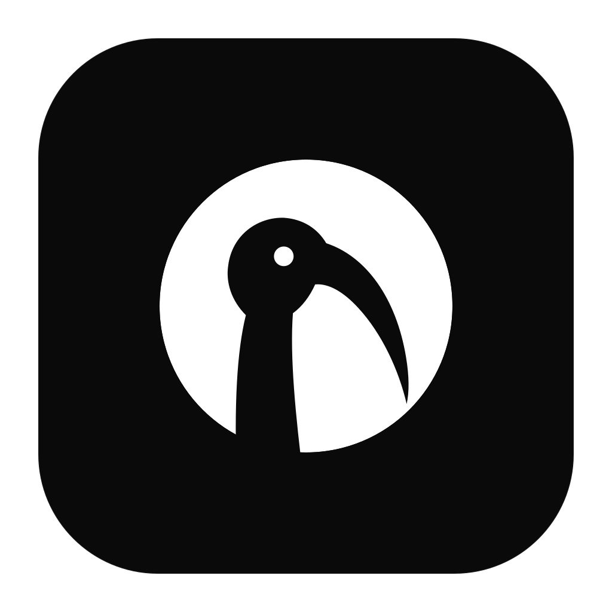
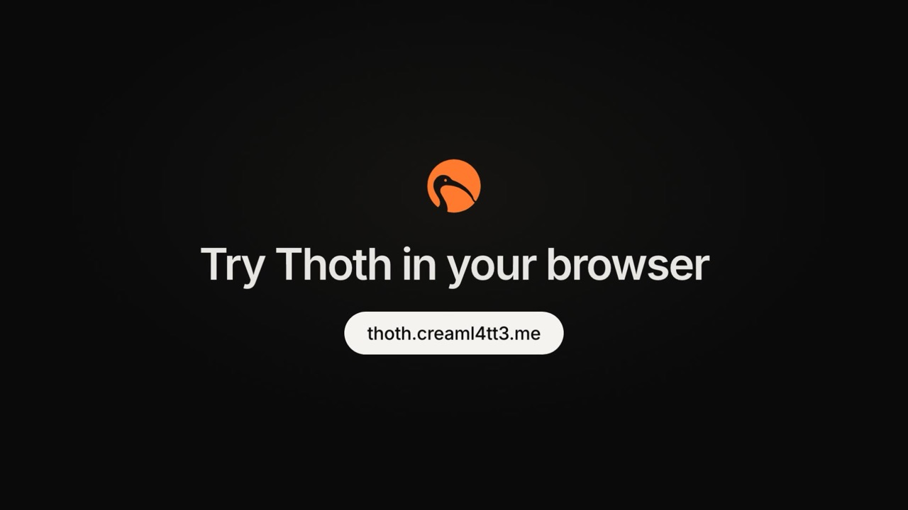

<p align="center">
  
</p>

<h1 align="center">Thoth</h1>

<p align="center">
  Notes as Markdown files on your computer, shared when you choose.<br>
  <a href="https://thothnotes.com">Website</a> ·
  <a href="https://thothnotes.com/#download">Download</a> ·
  <a href="https://thothnotes.com/app/">Web app</a> ·
  <a href="https://thothnotes.com/changelog/">Changelog</a> ·
  <a href="https://thothnotes.com/blog/">Blog</a>
</p>

<p align="center">
  <a href="https://github.com/Creaml4tt3/thoth/releases/latest"></a>
  <a href="LICENSE"></a>
  
</p>

Thoth is a local-first, open-source knowledge workspace. Your notes are Markdown files you own. Workspaces for
working with others are optional, run on a server anyone can host, and speak an open protocol. AI assistants run on
the command-line tools you already have, and nothing they propose is written until you approve it.

<p align="center">
  <a href="https://thothnotes.com/#video"></a>
  <br>
  <sub>▶ <a href="https://thothnotes.com/#video">Watch the 90-second tour</a> (English and Thai, with captions)</sub>
</p>

## Features

- **Your notes are files.** A Private Space is a folder of Markdown files on your computer. It works offline, needs
  no account, and stays readable in any text editor, even if you stop using Thoth.
- **Blocks and Plain, one file.** Write with blocks, a slash menu and toggles, or switch to Plain to edit the
  Markdown itself with a live preview. Switching never rewrites text you did not touch.
- **Bring your notes.** Import a Notion export or an Obsidian vault. Links are kept, and a report lists anything that
  could not come across.
- **Shared workspaces.** Copy or move pages and whole folders into a workspace to work with others, as owners,
  editors or viewers. Earlier versions of each page are kept.
- **No silent overwrites.** Thoth saves only if the page is still the version you opened. If someone or another app
  changed it, you choose: keep mine, keep theirs, or keep both.
- **AI edits you review first.** The Agent Hub runs Claude Code or Codex, which you install yourself, on the pages
  you pick. Each proposed change is shown as a diff, and nothing is written until you choose Apply.
- **Connected apps.** A read-only MCP server lets AI tools such as Claude Desktop or Cursor search and read the
  pages you share. Off until you switch it on.
- **An open protocol.** Clients and servers talk over a documented REST API with an OpenAPI description and a
  conformance suite, so anyone can build another server or client.
- **English and Thai**, in the apps and on the website.

## Install the desktop app

Download the latest version from **[thothnotes.com](https://thothnotes.com/#download)** or the
[GitHub releases](https://github.com/Creaml4tt3/thoth/releases/latest). The app tells you when a new version is out
and can update itself.

| Platform | File |
| --- | --- |
| macOS 11 or later (Apple silicon and Intel) | `Thoth_<version>_universal.dmg` |
| Windows x64 | `Thoth_<version>_x64-setup.exe`, or `Thoth_<version>_x64_en-US.msi` |
| Linux x64 | `Thoth_<version>_amd64.AppImage`, or `Thoth_<version>_amd64.deb` for Debian and Ubuntu |

Every release has a `SHA256SUMS` file next to the installers.

The builds are not signed with a paid developer certificate yet, so the first launch asks once:

- **macOS** may say it cannot check the app for malicious software. Open **System Settings → Privacy & Security**
  and choose **Open Anyway**.
- **Windows** SmartScreen may warn about an unknown publisher. Choose **More info → Run anyway**.
- **Linux AppImage:** make the file executable (`chmod +x Thoth_*.AppImage`), then run it.

To use the AI assistant, install [Claude Code](https://docs.claude.com/en/docs/claude-code/overview) or
[Codex](https://github.com/openai/codex) yourself and sign in to it; Thoth finds it and runs it for you.

## Try the web app

The [web app](https://thothnotes.com/app/) opens workspaces on a free **demo server**. Sign in with Google or GitHub.
The demo has limits (3 workspaces per account, 10 members and 200 pages per workspace), accounts unused for 90 days are deleted, and
the demo may be reset, so keep anything important in your Private Space. The desktop app can use the demo server
too (Settings → Servers).

## Host your own server

The server is the same one that runs the demo, without its limits: Node.js 24 and PostgreSQL, packaged as a
container image. The quickest start runs both with Podman or Docker:

```sh
git clone https://github.com/Creaml4tt3/thoth && cd thoth
export THOTH_DB_PASSWORD="$(openssl rand -base64 24 | tr -d '/+=')"   # keep it somewhere safe; it is not stored in the repo
podman compose up --build -d          # or: docker compose up --build -d
```

The server listens on `http://127.0.0.1:8080`. Create a user, a workspace and an access token with the admin CLI:

```sh
podman compose exec server node src/cli.ts create-user --name "Ada"                 # prints the user ID
podman compose exec server node src/cli.ts create-workspace --name "Team"           # prints the workspace ID
podman compose exec server node src/cli.ts add-member --workspace <workspace-id> --user <user-id> --role owner
podman compose exec server node src/cli.ts create-token --user <user-id> --out /data/ada.token
```

Then, in the desktop app, open **Settings → Servers → Add server** with the server's address and the token.

### With your own PostgreSQL and sign-in provider

If you already run PostgreSQL 14 or newer (managed or not) and an OpenID Connect provider (Keycloak, Authentik,
Zitadel, Entra ID...), run only the server container:

```sh
cp server.env.example server.env && chmod 600 server.env   # fill in DATABASE_URL, PUBLIC_URL and OIDC_*; git-ignored
podman compose -f compose.external.yaml up --build -d       # or: docker compose -f compose.external.yaml up --build -d
```

Register `https://<your PUBLIC_URL>/auth/callback/oidc` as the redirect URI at your provider, and put an HTTPS
reverse proxy in front of `127.0.0.1:8080`. The server creates its tables on first start, so the database user needs
the right to `CREATE EXTENSION pg_trgm` (or an administrator runs it once). People then add the server in the desktop
app and sign in with your provider; no access tokens to hand out.

Without containers it is a plain Node 24 app: `pnpm install --prod --filter @thoth/server...`, export the same
variables, then `node apps/server/src/main.ts`.

For Google or GitHub sign-in, HTTPS, limits, CORS, rate limiting and backups, read
**[`apps/server/README.md`](apps/server/README.md)**. The hosted demo's own setup (Vercel and Neon) is in
[`docs/deploy/trial.md`](docs/deploy/trial.md).

The web client is built for one server, fixed when it is built:
`VITE_DEFAULT_SERVER=https://api.example.org pnpm --filter @thoth/web build` writes it to `apps/web/dist`, to serve
under `/app/` (see [`docs/deploy/trial.md`](docs/deploy/trial.md), "Website project").

## Build from source

Requires Node 24 or later, [pnpm](https://pnpm.io) (`corepack enable`), and Rust 1.90 or later with the
[Tauri prerequisites](https://v2.tauri.app/start/prerequisites/) for your system.

```sh
git clone https://github.com/Creaml4tt3/thoth && cd thoth
pnpm install
pnpm --filter @thoth/desktop tauri dev     # run the desktop app
pnpm --filter @thoth/desktop tauri build   # build installers for this machine
```

Checks:

```sh
pnpm check          # typecheck, schema and OpenAPI drift checks, all unit and integration tests
pnpm test           # tests only
pnpm e2e            # Playwright: the real UI on the real Rust host (needs: npx playwright install chromium-headless-shell)
pnpm test:server    # the server against PostgreSQL in Podman
pnpm schemas        # regenerate protocol/schemas from the Zod schemas
```

Packages ship TypeScript source and run directly on Node's type stripping. Use erasable syntax only: no enums,
namespaces or parameter properties.

## Repository layout

```text
apps/
  desktop/              The desktop app: React UI (Vite) and src-tauri/, the Tauri 2 shell
  web/                  The web client for one workspace server
  server/               The reference workspace server: Fastify 5 and PostgreSQL, admin CLI, Containerfile
crates/
  thoth-host/           Rust host: scoped file access, SQLite, file watcher, agent runner, updates
  thoth-mcp/            The read-only MCP server for other apps (ADR-0021)
packages/
  domain/               IDs, paths, hashing, core entity schemas
  content/              Markdown and frontmatter parsing, link resolution and rewriting
  editor/               Tiptap schema and the byte-preserving Markdown serializer
  local-store/          The Private Space: atomic compare-and-swap writes, journal, SQLite and FTS5 index
  importer-core/        ZIP reader, safe sources, the staged and resumable import pipeline
  importer-notion/      Notion exports
  importer-obsidian/    Obsidian vaults
  transfer/             Copy and move between the Private Space and workspaces, with crash recovery
  workspace-protocol/   The workspace protocol's Zod schemas and route registry
  workspace-client/     A typed client for the protocol
  agent-core/           The Agent Hub: run records, context staging, review and apply
  agent-claude/         The Claude Code adapter
  agent-codex/          The Codex adapter
  platform/             The platform contract between the UI and the host
  app-ui/               UI shared by the desktop app and the web client, and the English and Thai strings
  ui/                   Design tokens ("Ink & Moon")
protocol/               openapi.yaml, JSON schemas and the conformance suite
docs/
  adr/                  Architecture decision records: why things are the way they are
  architecture/         Content contract, import research, the implementation plan
  protocol/             The workspace protocol and sign-in
  deploy/               Releasing, and the hosted demo
  legal/                Privacy notice and terms of the hosted demo and website
design/                 Brand files and the design notes
tests/                  End-to-end, port contract, protocol and release tests, and fixtures
```

## Documentation

- [Architecture decision records](docs/adr/README.md): every design decision and its reasons.
- [Workspace protocol](docs/protocol/README.md) and its [OpenAPI description](protocol/openapi.yaml).
- [Server](apps/server/README.md): configuration, sign-in, containers and the admin CLI.
- [Releasing](docs/deploy/release.md): how versions are built, signed and published.
- [Design notes](design/DESIGN.md): the look, the type and the motion rules.

## Contributing

Contributions are welcome. Read [`CONTRIBUTING.md`](CONTRIBUTING.md) first: commits need a DCO sign-off
(`git commit -s`), and a change to a recorded decision needs an ADR. Bugs and ideas are welcome as
[GitHub issues](https://github.com/Creaml4tt3/thoth/issues), or through **Send feedback** in the app.

To report a security problem, please do not open an issue: email **security@thothnotes.com** (see
[`SECURITY.md`](SECURITY.md)).

## License

[Apache-2.0](LICENSE). See [ADR-0011](docs/adr/0011-license-and-contribution-policy.md) for the license and
contribution policy.
